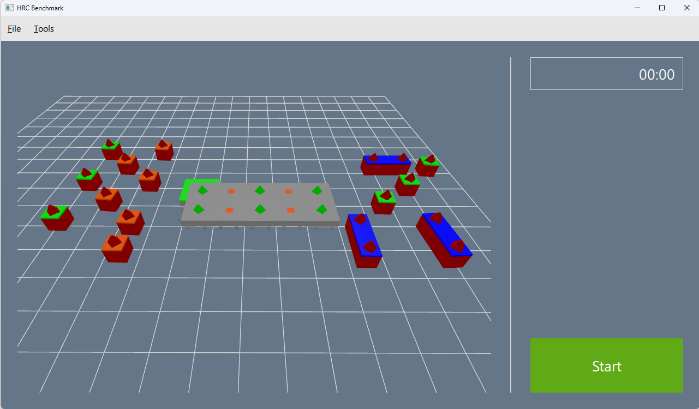

# Comparing Static and Dynamic Human-Robot Task Sharing - Experiment Software

This C++17/Qt 6 application runs human-robot task-sharing experiments with a Franka Emika Panda robot and an Intel RealSense camera. It coordinates assembly steps under static and dynamic scheduling policies, triggers human interruptions, presents questionnaires, and records session data as JSONL. The build uses CMake and vcpkg and was tested on Windows 11 and Ubuntu 24.

## Contents

- [Getting started](#getting-started): dependencies, Python integration, and builds on Windows and Linux.
- [Troubleshooting](#troubleshooting): QML deployment, Python startup, and build diagnostics.
- [Hardware configuration](#hardware-configuration): gripper geometry, tool mass, and camera poses.
- [Running a study session](#running-a-study-session): user interface, task loading, questionnaires, camera navigation, and simulation.
- [Questionnaire strings](#questionnaire-strings): files to edit when adapting questionnaire language.
- [Operation timing for scheduling](#operation-timing-for-scheduling): human and robot step durations and interruption duration.
- [Related materials and citation](#related-materials-and-citation): analysis data, protocols, study materials, and publication details.

## Getting started

### Windows
#### Disk space and path length
vcpkg compiles all dependencies from source. **Reserve at least 70 GB** of free disk space on the drive that will host the repository. Use a **short repository path** (e.g. `C:\hrc`) — MSVC imposes a maximum path length and deeply nested vcpkg build trees will exceed it on longer paths.

#### VCPKG
Checkout this project and submodules, then install vcpkg dependencies using: 
 ```bash
  cd .\tools\vcpkg
  .\bootstrap-vcpkg.bat
  .\vcpkg.exe install boost-serialization catch2 poco[net] eigen3 nlohmann-json opencv realsense2 pcl[vtk] spdlog --triplet x64-windows
```
Poco is needed to build libfranka.

#### Qt
[Download](https://www.qt.io/development/download-qt-installer-oss) and install the community version of Qt 6 using the online installer. It ships with prebuilt MSVC binaries. We opted against building it through vcpkg due to path resolution errors. Set `CMAKE_PREFIX_PATH` in `CMakeUserPresets.json` to the installation directory, for example `C:/Qt/6.8.2/msvc2022_64`.

The following Qt components must be installed (select them in the Qt Online Installer):
- Qt Core
- Qt GUI
- Qt Quick / Qt Quick Controls 2
- Qt Quick 3D
- Qt QML
- Qt Widgets

### Linux 
Our vcpkg dependencies have themselves dependencies on the distribution's package manager:
```bash
  sudo apt-get install build-essential tar curl zip unzip  -y && 
  sudo apt-get install bison -y && 
  sudo apt-get install python3-setuptools -y && 
  sudo apt-get install libx11-dev libxft-dev libxext-dev -y && 
  sudo apt-get install libxmu-dev libxi-dev libgl-dev -y && 
  sudo apt-get install autoconf -y && 
  sudo apt-get install libtool -y && 
  sudo apt-get install xorg-dev -y && 
  sudo apt-get install autoconf-archive -y && 
  sudo apt-get install libdbus-1-dev libxi-dev libxtst-dev  -y && 
  sudo apt-get install libudev-dev -y && 
  sudo apt-get install libxt-dev -y && 
  sudo apt-get install libfmt-dev -y && 
  sudo apt-get install libglvnd-dev -y && 
  sudo apt-get install libx11-dev libgles2-mesa-dev -y &&
  sudo apt-get install libfontconfig1-dev   libfreetype6-dev   libx11-dev    libx11-xcb-dev libxext-dev   libxfixes-dev    libxi-dev    libxrender-dev    libxcb1-dev    libxcb-glx0-dev    libxcb-keysyms1-dev    libxcb-image0-dev    libxcb-shm0-dev    libxcb-icccm4-dev    libxcb-sync-dev    libxcb-xfixes0-dev    libxcb-shape0-dev    libxcb-randr0-dev    libxcb-render-util0-dev    libxcb-util-dev    libxcb-xinerama0-dev    libxcb-xkb-dev    libxkbcommon-dev    libxkbcommon-x11-dev -y &&
  sudo apt-get install python3-dev 
  sudo apt-get install flex
    sudo apt-get install '^libxcb.*-dev' libx11-xcb-dev libglu1-mesa-dev libxrender-dev libxi-dev libxkbcommon-dev libxkbcommon-x11-dev libegl1-mesa-dev
```
Afterwards, you can install the dependencies as usual:
```shell
  cd ./tools/vcpkg
  sudo ./bootstrap-vcpkg.sh
  ./vcpkg install boost-serialization catch2 poco eigen3 qtbase qtquick3d nlohmann-json opencv  realsense2 pcl[vtk] spdlog
```

### Python integration
1. Install Python 3.11+ and ensure it is on your system `PATH`. Required packages: `networkx`, `matplotlib`. Make sure you downloaded the debug binaries during install.
2. CMake's `FindPython` will locate Python automatically via `PATH` and the Windows registry. If you need to pin a specific installation, set `Python_ROOT_DIR` as a system environment variable pointing to that directory.

Install the Python packages into the interpreter selected by CMake:

```cmd
python -m pip install networkx matplotlib
```

If you encounter issues, check the CMake output to see which Python version is found and used. `PYTHONHOME` is an optional runtime override; see the Python startup guidance under [Troubleshooting](#troubleshooting).

### Building

Run configure and build commands from the repository root. CMake copies `data/` into `out/build/<preset>/` during configuration. Use that build directory as the working directory when launching the application.

#### Option A — Command line

**Windows** (run inside a *Visual Studio 2022 Developer Command Prompt* so `cl.exe` is on `PATH`):

```cmd
cmake --preset x64-debug
cmake --build out/build/x64-debug
```

Use `x64-release` for a `RelWithDebInfo` build. Run the result:

```cmd
cd out\build\x64-debug
src\App\application.exe
```

**Linux** — first add a Linux preset to `CMakeUserPresets.json` (the file is not committed; create it if it does not exist):

```json
{
  "version": 3,
  "configurePresets": [
    {
      "name": "linux-debug",
      "displayName": "Linux Debug",
      "inherits": "linux-base",
      "environment": {
        "CMAKE_PREFIX_PATH": "/home/<you>/Qt/6.8.2/gcc_64",
        "Python_ROOT_DIR": "/usr",
        "PYTHONHOME": "/usr"
      }
    }
  ]
}
```

Then configure, build, and run:

```bash
cmake --preset linux-debug
cmake --build out/build/linux-debug
cd out/build/linux-debug
./src/App/application
```

**Tests (both platforms):**

```bash
cd out/build/<preset> && ctest
```

#### Option B — IDE (GUI)

**Windows — Visual Studio 2022**

1. Open Visual Studio 2022 and choose **File → Open → CMake...**, then select `CMakeLists.txt` at the repository root. Visual Studio has built-in CMake support and reads `CMakePresets.json` automatically.
2. Set machine-specific paths in `CMakeUserPresets.json` as described in [Option A](#option-a--command-line) above. Visual Studio picks up the file on the next re-configure.
3. Select the desired preset (`x64-debug` or `x64-release`) from the configuration drop-down in the toolbar.
4. Build with **Build → Build All** or **Ctrl+Shift+B**.
5. To run, set the startup item to `application.exe` via the run drop-down and press **F5** (debug) or **Ctrl+F5** (without debugger).

**Linux — Qt Creator**

1. Open Qt Creator and choose **File → Open File or Project**, then select `CMakeLists.txt`.
2. Qt Creator detects the presets from `CMakePresets.json`. Select `linux-debug` in the **Configure Project** dialog.
3. If machine-specific paths are not yet set, create or edit `CMakeUserPresets.json` as described in [Option A](#option-a--command-line) above. Qt Creator picks up the file automatically on the next re-configure.
4. Click **Build** (hammer icon) or press **Ctrl+B**.
5. To run, select the `application` target in the kit selector and press **Ctrl+R**.

## Troubleshooting

### QML modules fail to load at startup (Windows)

The application's own QML modules (`App`, `Components`, `HrcModels`, `Mock`, and `Core`) are built with `qt_add_qml_module`. The UI resources are embedded under `/qt/qml`; `src/App/main.cpp` adds `qrc:/qt/qml` to the import path and loads `qrc:/qt/qml/App/main.qml`. These modules do not require a filesystem import-path override.

Qt's own QML modules, including Qt Quick Controls and Qt Quick 3D, must also be available from the matching Qt installation or deployed beside the executable. On MSVC builds, `src/App/CMakeLists.txt` copies target runtime DLLs and runs `Qt6::windeployqt` after linking. That command does not pass `--qmldir`, so it does not explicitly scan the application's QML sources for imports.

If startup reports a missing Qt QML module:

1. Check `Qt6_DIR` in the build directory's `CMakeCache.txt` to identify the Qt installation selected by CMake. Use its deployment tool and modules, matching the build's compiler, architecture, and configuration.
2. From the repository root, run the matching deployment tool with a QML source scan. In a Developer Command Prompt, for example:

   ```cmd
   "C:\Qt\6.8.2\msvc2022_64\bin\windeployqt.exe" --release --qmldir src\App out\build\x64-release\src\App\application.exe
   ```

   Replace the Qt path and executable path with those used by your build. For `x64-debug`, use `--debug` and the debug executable. See [Qt's Windows deployment documentation](https://doc.qt.io/qt-6/windows-deployment.html) for the QML scanning options.
3. If loading still fails, inspect the application's `QML Import Paths:` output. For a detailed trace, set `QML_IMPORT_TRACE=1` in the launching shell before starting the application. Close that shell after diagnosis.

Do not set a system-wide `QML2_IMPORT_PATH` pointing into vcpkg when using the separately installed Windows Qt binaries. Check existing `QML_IMPORT_PATH` and `QML2_IMPORT_PATH` overrides for paths to another Qt installation. If a development launch needs an explicit import path, set `QML_IMPORT_PATH` only in that launching shell to the selected Qt installation's `qml` directory. This supplies a search path; it does not install missing modules or resolve incompatible plugin binaries. Qt documents the search paths and tracing in [QML Import Path](https://doc.qt.io/qt-6.8/qtqml-syntax-imports.html#qml-import-path).

### `ModuleNotFoundError: No module named 'networkx'` on start-up

Symptom: `application.exe` prints `Could not find platform independent libraries <prefix>` followed by `ModuleNotFoundError: No module named 'networkx'`, although `networkx` is installed for the Python found by CMake.

Cause: the embedded interpreter derives its prefix (and thus `site-packages`) from the location of the executable, and `application.exe` has no `Lib/` folder next to it. Without a prefix, `site-packages` is not added to `sys.path`. Launching from an IDE hid this on machines whose `CMakeUserPresets.json` set `PYTHONHOME` in its `environment` block, because the IDE passes that variable to the started program. Starting the exe from a plain shell or by double-click does not.

Fix: the application sets the Python home to the directory of the `Python_EXECUTABLE` found by CMake (compile definition `HRC_PYTHON_HOME`). Re-run the CMake configure and rebuild after changing the Python installation. A `PYTHONHOME` environment variable still takes precedence if set.

### `ninja: error: failed recompaction: Permission denied`

Symptom: the build stops during "Re-running CMake" with `ninja: error: failed recompaction: Permission denied` and `Configuring incomplete`.

Cause: ninja's state files in `out/build/<preset>` are held open by another build of the same preset, for example one started from the IDE.

Fix: wait for the other build to finish (or stop it) and run the build again.

### Expected warnings

These warnings appear during configure and do not indicate a problem:

- `The detected C++ compiler (MSVC) is unsupported for correct builds under cross-compilation` (printed several times): raised by the vcpkg VTK package, which this project does not cross-compile.
- `Could NOT find WrapVulkanHeaders` and `Could NOT find Qt6TaskTree`, followed by a warning that `Qt6QmlAssetDownloaderPrivate` is considered not found: optional Qt components that the application does not use.
- `Compatibility with CMake < 3.10 will be removed from a future version of CMake` for `_libfranka-src/CMakeLists.txt` and `_libfranka-src/common/CMakeLists.txt`: libfranka is fetched at build time and declares an old minimum CMake version. The preset passes `CMAKE_POLICY_VERSION_MINIMUM=3.5` so that it still configures.
- `find_package(unofficial-utf8proc) is deprecated`: raised by the vcpkg Poco package, a dependency of libfranka.
- `The core target is a QML module with target path Core ... OUTPUT_DIRECTORY ... should end in the same target path`: affects only `qmllint` tooling, which this project does not use.
- `fatal: not a git repository ... Had to git clone more than once: 2 times` while fetching libfranka: a transient clone failure that CMake retries automatically. It is more likely on slow drives.

## Hardware configuration

### TCP offset
The TCP offset in `src/franka_robot.cpp` (`flange_T_tcp`) is set to 0.124 m along the flange Z-axis — the measured distance from the Franka flange face to the tip of the Franka Hand fingers. If your gripper or finger geometry differs, update this value.

### Force-torque sensor adapter
During the study a force-torque sensor was mounted between the robot flange and the gripper as part of a parallel experiment (adding 0.065 m to the TCP offset and 0.372 kg to the tool mass). These contributions are **commented out** in the release version so the software works with the bare Franka Hand out of the box. If you mount a sensor or other adapter between the flange and gripper, restore and adjust the following:

- `src/franka_robot.cpp` — `flange_T_tcp`: uncomment `+ 0.065` and set the adapter height.
- `src/franka_util.cpp` — `tool_mass()`, `tool_center_of_mass()`, `tool_inertia()`: set `m_fts` to the sensor mass and verify the center-of-mass position `c_fts`.

### Camera poses

Two sets of poses in `src/franka_robot.cpp` are workspace-specific and must be verified when the robot or workspace layout changes:

- **Exploration poses** (lines 48–60, `franka_robot` constructor): five overhead TCP poses (x, y, z in metres relative to the robot base) through which the robot sweeps during the exploration sequence to locate all parts with the RealSense camera. Adjust these if the workspace footprint or robot mounting position changes.
- **Camera-to-flange transform** (`world_T_camera`, lines 183–195): a hardcoded 4×4 affine matrix (`flange_T_camera`) describing the pose of the RealSense D435i relative to the Franka flange. Re-measure and update this matrix if the camera mount is repositioned or replaced.

## Running a study session



The interface displays the assembly scene, the assigned operations, and the participant's task controls. Use the session protocol linked under [Related materials and citation](#related-materials-and-citation) for the sequence of participant and experimenter actions.

### Loading a task
There are two ways to point the application at a task:

**Option A — configuration file (recommended for study runs).**
Use *File → Open* and select a configuration file. The main-study configurations are `studies/main/configuration_dynamic.json` and `studies/main/configuration_static.json` in the repository. The file specifies the task description path, which actors are enabled (human / robot), which operation indices trigger an interruption, and whether the scheduler re-plans after an interruption. All settings are applied at once.

**Option B — manual settings.**
Use *Tools → Options* to set the task description path, enable or disable the human and robot actors, choose the assembly step indices that trigger interruptions (for example `[2,4]`), and enable or disable rescheduling after an interruption. This is useful for quick tests without a full configuration file.

> Load a task before pressing *Start*. Starting without a loaded task description causes the application to crash.

### Running the experiment
1. Start the application from the build output directory (`out/build/<preset>/`).
2. Load a configuration file via *File → Open*.
3. Press **Start**. The robot begins its exploration sequence to locate parts.
4. Once the task is running, the button label changes to **Assembly step completed**. The participant presses this after each completed human assembly step.
5. An interruption dialog appears automatically at the configured operation indices. After the secondary task, the participant presses **I am back** to resume.
6. Questionnaires (NASA-TLX, SUS, fluency under *Perfomance and Interaction Quality*, ATI, Demographics, Experience) are accessible under the *Tools* menu and can be filled in between runs.
7. Study data is logged automatically as timestamped JSONL files in the `logs/` subdirectory of the working directory.

### 3D scene camera navigation

Use **W**, **A**, **S**, and **D** to navigate the 3D scene camera. To change its initial position and viewing direction, edit the camera values in `src/App/Scene.qml` and rebuild the application.

### Simulation mode
Set `connect_to_hardware: false` on the `Task` element in `src/App/Experiment.qml` and rebuild the application to run without physical hardware. The software will simulate robot actions and camera observations, which is useful for testing scheduling logic.

## Questionnaire strings

There is no central translation file — questionnaire item text is hardcoded inline as `ListModel`/`ListElement` entries directly in the QML files under `src/App/`. Sites that want to translate the questionnaires (or use a different validated instrument version) should edit the `label`/`description` strings directly in:

| File | Questionnaire |
|---|---|
| `src/App/NASA_TLX.qml` | NASA-TLX dimension labels/descriptions and pairwise comparison labels |
| `src/App/SUS.qml` | System Usability Scale (SUS) items |
| `src/App/ATI.qml` | Affinity for Technology Interaction (ATI) items |
| `src/App/PerformanceInteraction.qml` | Human-robot fluency/teamwork items |
| `src/App/Experience.qml` | Prior-experience questions |
| `src/App/Demographics.qml` | Demographics form (labels, gender/answer options) |

`TLXRatings.qml` and `TLXWeights.qml` are sub-views loaded by `NASA_TLX.qml`; they render the `questionaire`/`comparisions` models rather than defining their own text.

## Operation timing for scheduling

The scheduler assigns every operation the same flat duration in seconds for a given agent. These are hardcoded constants at the top of `core::schedule::schedule()` in `src/core/hrc_schedule.cpp`:

```cpp
const int robot_speed = 10;
const int human_speed = 5;
const int interrupt_duration = 30;
```

- `robot_speed` / `human_speed` — duration (in scheduler time steps) assigned to every operation for the robot / human agent respectively, passed to the Python `list_scheduler` as each agent's per-operation duration.
- `interrupt_duration` — number of time steps the human is marked unavailable when scheduling around an interruption.

To change how long human or robot steps are assumed to take (and thus how the scheduler interleaves operations), edit these three constants directly.
## Related materials and citation

### Related materials

| Material | Access |
|---|---|
| Data and analysis capsule | [Code Ocean](https://doi.org/10.24433/CO.1115223.v1) |
| Study protocol | [protocols.io](https://doi.org/10.17504/protocols.io.dm6gp4z1pgzp/v1) |
| Session protocol | [protocols.io](https://doi.org/10.17504/protocols.io.261geq51jg47/v1) |
| Printable study materials | [prints/](prints/): participant information, consent forms, experimenter checklists, and workspace reference sheets |
| Supplemental material | Link to be added with the publication; covers workstation setup, calibration, data interpretation, and replication evaluation. |
| Video walkthrough | Link to be added. |

### Main publication

Jonathan Hümmer, Nico Höllerich, Dominik Riedelbauch, and Dominik Henrich. *Comparing Static and Dynamic Human-Robot Task Sharing - A Reproducible User Study.*

Publication link, DOI, year, volume, and pages: to be added when assigned. Cite the main article when reporting use of the study platform or protocol; use [CITATION.cff](CITATION.cff) for the software citation.
